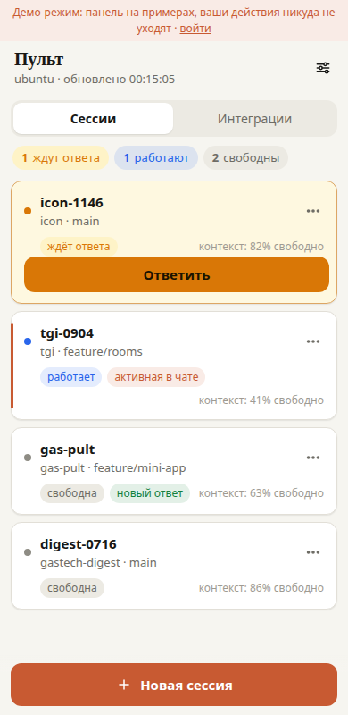
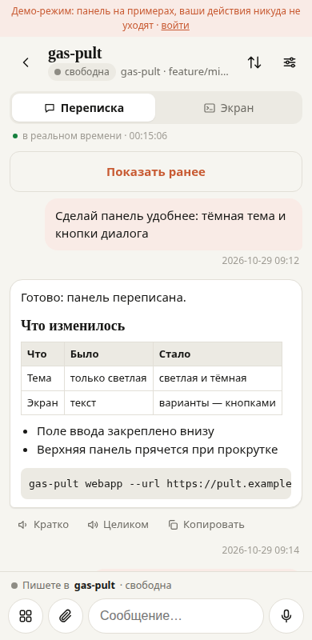
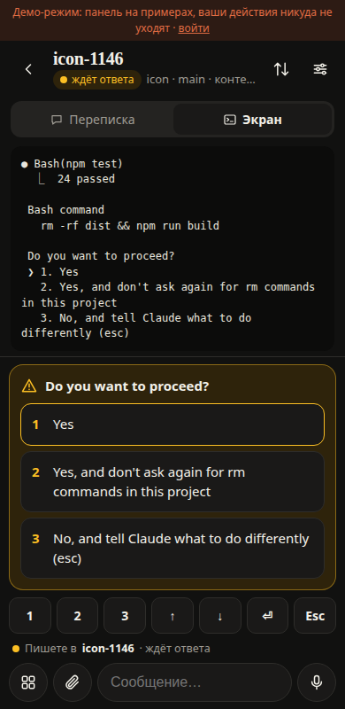
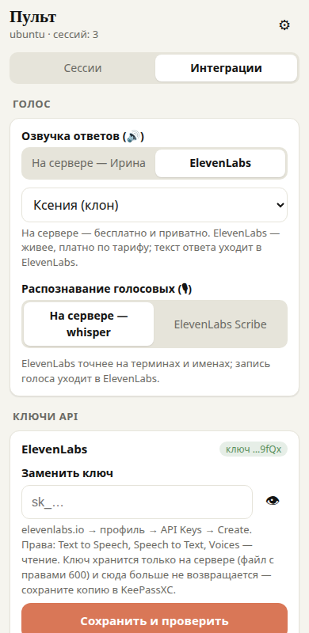
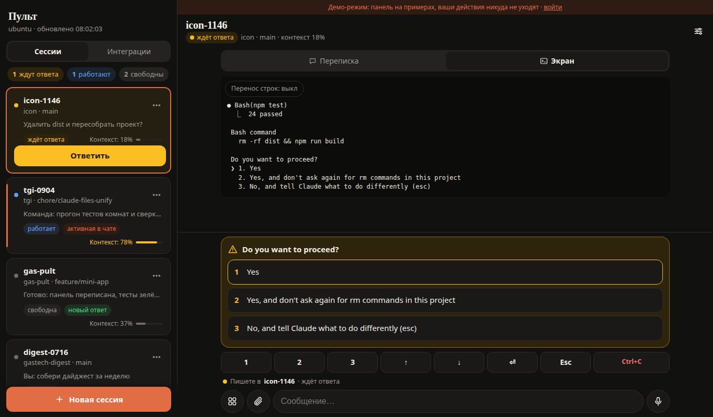
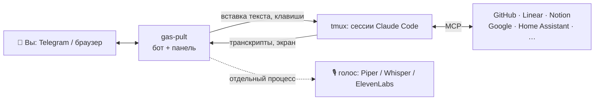

<div align="center">

# gas-pult

**Пульт для Claude Code в телефоне.** Claude работает на вашем сервере — вы получаете ответы, отвечаете голосом
и кнопкой, подключаете сервисы и не сидите у терминала.

[](https://github.com/gvriil/gas-pult/actions/workflows/ci.yml)
[](pyproject.toml)
[](LICENSE)
[](pyproject.toml)

 
 
<br>

</div>

---

## Зачем

Claude Code делает большую работу — читает код, гоняет тесты, правит десятки файлов — и это занимает минуты,
а иногда час. Сидеть и смотреть в терминал — главная причина, по которой люди бросают агентов: «медленно».
Пульт меняет порядок: **Claude работает, вы живёте**. Закончил ход или спрашивает разрешение — приходит сообщение;
ответили голосом из такси — работа продолжается. Пять проектов параллельно — пять сессий в одном списке.

| Без пульта | С пультом |
|---|---|
| Ждёте у терминала, пока Claude думает | Телефон в кармане, ответ придёт сам — текстом или голосом |
| Claude застрял на «Можно выполнить?» и ждёт вас час | Вопрос приходит сразу, варианты — кнопками |
| Одна сессия, потому что за несколькими не уследить | Все сессии в одном списке: кто работает, кто ждёт, сколько контекста |
| Голосом — никак | Говорите задачу — Claude её получает; ответ можно послушать |

## Что можно делать — не только код

Claude Code с подключёнными сервисами (MCP) — исполнитель для любой работы за компьютером. Пульт даёт к нему
доступ с телефона.

| Задача | Как это выглядит |
|---|---|
| **Разработка, вайб-кодинг** | «Добавь фильтр по дате в отчёт и прогони тесты» — голосом; ответ — в переписке, `npm test` — кнопкой ▶️ |
| **Задачи и проекты** (Linear) | Пришлите `GAS-123` — пульт откроет сессию по задаче; Claude прочитает описание, сделает, сменит статус |
| **Документы и базы** (Notion, Google Диск) | «Собери из заметок за неделю отчёт в Notion» |
| **Почта и календарь** (Gmail, Google Calendar) | «Какие встречи завтра и что по ним ответить в почте» |
| **Данные и отчёты** | «Выгрузи из базы продажи за октябрь и посчитай по менеджерам» — таблица в ответе |
| **Сервер и деплой** | «Почему упал сервис — посмотри логи»; перезапуск — кнопкой с подтверждением |
| **Умный дом** (Home Assistant) | «Выключи свет на кухне и поставь отопление на 20» |
| **Исследования** | «Сравни три CRM для малого бизнеса, итог — таблицей» — и послушать вывод в дороге |

Подключение сервиса — в панели «Интеграции»: шаблон, понятные поля, вход в сервис прямо с телефона.
Пошагово — [docs/MINI_APP.md](docs/MINI_APP.md).
Подключить пульт для другой компании — что нужно, сколько стоит и что допилить: [docs/ONBOARDING-BUSINESS.md](docs/ONBOARDING-BUSINESS.md).

## Два интерфейса

| 💬 **Чат с ботом** | 📱 **Панель** (Telegram Mini App, и в браузере) |
|---|---|
| Ответы и вопросы Claude приходят сообщениями | Все сессии на одном экране, вся переписка, озвучка любого ответа |
| Текст, голосовое, фото, файл — в активную сессию | Поле с диктовкой, 🎙, ＋ фото с камеры и файлы, ☰ меню действий |
| Кнопки 🔊 ✅ ✏️, 1/2/3/↑/↓ для диалогов | Диалоги Claude — крупными кнопками; «▶️ Выполнить» с результатом под командой |
| Меню: 🆕 Новая · 🔀 Переключить · 📊 Сводка · ⚡ Команды · 📋 Окна · ⚙️ | Интеграции (MCP), ключи API, голос ElevenLabs, светлая и тёмная тема |
| Ничего настраивать не нужно | Нужен HTTPS-адрес: временный за минуту или свой домен — [пошагово](docs/MINI_APP.md) |

## Как это устроено



Пульт не вмешивается в Claude Code: читает его транскрипты (ход закончен — ответ отправлен), смотрит экран окна
и вставляет ваш текст как обычный ввод. Ничего не патчит и работает с любой версией Claude Code.
Пульт — тонкий интерфейс: решения принимает Claude, доступ к сервисам дают MCP-серверы.
Подробнее — [docs/ARCHITECTURE.md](docs/ARCHITECTURE.md).

## Что нужно

| | Обязательно | По желанию |
|---|---|---|
| Система | Linux (systemd) или macOS (launchd) | — |
| Python | 3.11+ с `venv` (Ubuntu: `sudo apt install python3-venv`) | — |
| tmux | любой современный (`sudo apt install tmux` / `brew install tmux`) | — |
| Claude Code | [установлен](https://docs.claude.com/en/docs/claude-code) и вошли в аккаунт (`claude` → `/login`) | — |
| Telegram | бот от [@BotFather](https://t.me/BotFather) | — |
| Голос | — | от 2 ГБ свободной памяти и ~1 ГБ диска (Piper + Whisper); Silero ещё ~1 ГБ; или ключ ElevenLabs |
| Панель | — | HTTPS: `cloudflared` (временный адрес) или свой домен + Caddy |
| Интеграции | — | ключи сервисов; для некоторых MCP-серверов — Node.js или uv |

Пульт видит сессии Claude, запущенные в tmux-сессии `main` (или открытые из самого пульта). Сессия в обычном
терминале или в VS Code для пульта невидима.

## Быстрый старт

1. **Бот.** [@BotFather](https://t.me/BotFather) → `/newbot` → имя → скопируйте токен.
2. **Установка** — одна команда: поставит пакет, спросит токен, узнает ваш Telegram ID и запустит службу.

   ```bash
   curl -fsSL https://raw.githubusercontent.com/gvriil/gas-pult/main/install.sh | bash
   ```

   Не любите `curl | bash` — прочитайте скрипт и запустите из клона:
   `git clone https://github.com/gvriil/gas-pult && cd gas-pult && ./install.sh`.
   Ключи: `--silero` (естественные голоса, +1 ГБ), `--no-voice`, `--no-service`.
3. **Готово.** Откройте бота → `/start`. Проверка установки — `gas-pult doctor`.
4. **Панель** (по желанию): `gas-pult webapp --tunnel` — в меню бота появится «📱 Панель».
   Постоянный адрес на своём домене — [docs/MINI_APP.md](docs/MINI_APP.md).

<details>
<summary><b>Установка вручную (uv / pipx)</b></summary>

```bash
uv tool install "gas-pult[voice] @ git+https://github.com/gvriil/gas-pult"   # или pipx install …
gas-pult init                    # токен (скрытый ввод) + ваш ID по первому сообщению боту
gas-pult voices install irina    # голос
gas-pult doctor                  # проверка
gas-pult service install         # фоновая служба (systemd --user / launchd)
```
</details>

## Голос

| Движок | Где работает | Что даёт | Ставится |
|---|---|---|---|
| [Piper](https://github.com/OHF-Voice/piper1-gpl) | на вашем сервере | Ирина, Дмитрий, Денис, Руслан | `gas-pult[voice]` |
| [Silero v5](https://github.com/snakers4/silero-models) | на вашем сервере | Ксения, Бая, Ксения-2, Айдар, Евгений — естественнее | `gas-pult[silero]` (+torch ≈ 1 ГБ) |
| [faster-whisper](https://github.com/SYSTRAN/faster-whisper) | на вашем сервере | распознавание голосовых | `gas-pult[voice]` |
| [ElevenLabs](https://elevenlabs.io) | облако, ваш ключ | голоса аккаунта, распознавание Scribe | ключ в панели → «Интеграции» |

Модели сессий — не только Claude: в панели «Интеграции» → «Модели» можно добавить ключ OpenRouter, GLM (Z.ai) или
DeepSeek и выбирать поставщика при «Новой сессии» ([подробнее](docs/MINI_APP.md#модели-других-поставщиков--по-шагам)).

`gas-pult voices` — что установлено, `gas-pult voices install irina xenia` — скачать.

## Настройки

`~/.config/gas-pult/config.toml` — все ключи с пояснениями в [`config.example.toml`](config.example.toml):

```toml
owners = [123456789]                  # кто может управлять (несколько — через запятую)
session = "main"                      # сессия tmux
project_roots = ["~/projects", "~/worktrees"]
commands = [["▶️ Старт", "/shtab start"], ["🧪 Тесты", "Запусти тесты и доложи"]]   # свои кнопки ⚡
foreign = ['\bssh\s+prod\b']          # такие команды — без кнопки ▶️
digest_at = "09:00"                   # утренняя сводка «ждёт владельца» ("" — выкл.); /digest — сейчас
digest_github = "ваш-логин"           # PR старше 2 дней или с красным CI — через gh
```

После правки: `systemctl --user restart gas-pult` (macOS: `gas-pult service install`).

## Безопасность

Пульт — удалённое управление вашей машиной. Подробно — [SECURITY.md](SECURITY.md); главное:

- Принимает команды **только** от Telegram ID из `owners`. Панель проверяет подпись Telegram на каждом запросе;
  из браузера — вход одноразовым кодом, который приходит вам в Telegram.
- **Токен бота = ключ от машины**: `~/.config/gas-pult/token` (0600). Утёк — `/revoke` в @BotFather и `gas-pult init`.
- «▶️ Выполнить» — от вашего пользователя; опасное (удаление, `--force`, `reboot`) — со вторым подтверждением;
  `sudo` — только из списка `sudo_allow`. В выводе секреты маскируются.
- Голос — на вашем сервере, пока вы сами не выберете ElevenLabs. Ключи хранятся только на сервере
  и наружу не отдаются.

## Обновить и удалить

```bash
uv tool upgrade gas-pult    # или pipx upgrade gas-pult, или ./install.sh ещё раз
gas-pult service uninstall && uv tool uninstall gas-pult
rm -rf ~/.config/gas-pult ~/.local/share/gas-pult   # настройки, голоса, история
```

Открытая панель сама заметит новую версию и предложит обновиться; после — покажет «Что нового».

## Разработка

```bash
git clone https://github.com/gvriil/gas-pult && cd gas-pult
python3 -m venv .venv && .venv/bin/pip install -e ".[dev]"
.venv/bin/ruff check . && .venv/bin/pytest
gas-pult webapp --port 8765   # панель локально; http://127.0.0.1:8765/?demo — на демо-данных
```

Архитектура, как добавить кнопку, голос или шаблон интеграции — [docs/ARCHITECTURE.md](docs/ARCHITECTURE.md).
Правила — [CONTRIBUTING.md](CONTRIBUTING.md). История — [CHANGELOG.md](CHANGELOG.md). Постановка задач с Gemini — [GEMINI.md](GEMINI.md).

## Лицензия

[PolyForm Noncommercial 1.0.0](LICENSE): свободно для личного, учебного, исследовательского и некоммерческого
использования. **Коммерческое использование — по отдельной договорённости** с автором
([issue](https://github.com/gvriil/gas-pult/issues) или контакт в профиле). Сторонние компоненты — [NOTICE.md](NOTICE.md).

> gas-pult — независимый проект. Он не связан с Anthropic и не одобрен ею. Claude и Claude Code — товарные знаки Anthropic.

<details>
<summary><b>English summary</b></summary>

**gas-pult** is a phone remote for [Claude Code](https://docs.claude.com/en/docs/claude-code) sessions running in
tmux on your server. A Telegram bot forwards every finished Claude turn and every on-screen dialog (permissions,
`/model`, `/mcp`) and sends your text, voice notes, photos and files back. A Telegram Mini App (also usable in a
browser with a one-time code sent to Telegram) shows all sessions, the full conversation with text-to-speech for any
message, Claude's dialogs as buttons, run-buttons for shell blocks (with confirmation for destructive commands),
attachments from the camera, MCP integrations with guided forms and phone-friendly OAuth, API keys and an
ElevenLabs voice option. Voice runs locally by default (Piper, Silero, faster-whisper). Core is stdlib-only;
Linux (systemd) and macOS (launchd). The UI is in Russian. PolyForm Noncommercial 1.0.0.
</details>
