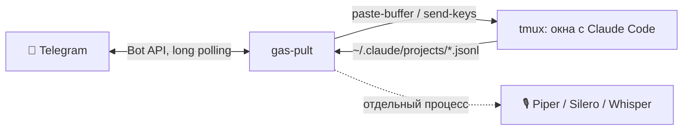

<div align="center">

# gas-pult

**Telegram-пульт для сессий Claude Code в tmux.**
Ответы, диалоги разрешений, голос и команды — с телефона, пока Claude работает на вашем сервере.

[](https://github.com/gvriil/gas-pult/actions/workflows/ci.yml)
[](pyproject.toml)
[](LICENSE)
[](pyproject.toml)

</div>

---

## Зачем

Claude Code работает долго: читает код, запускает тесты, спрашивает разрешения. Сидеть у терминала не нужно —
пульт присылает в Telegram каждый законченный ответ и каждый вопрос Claude, а вы отвечаете текстом, голосом
или кнопкой. Несколько сессий в разных проектах — одно окно чата.

## Возможности

| | |
|---|---|
| 📨 **Ответы сами приходят** | Любой законченный ход Claude в любом окне tmux — сообщением, с кнопками 🔊 ✅ ✏️ |
| ⏸ **Диалоги на экране** | Запрос разрешения, `/model`, `/mcp` — снимок экрана и кнопки 1 / 2 / 3 / ↑ / ↓ / ⏎ / Esc |
| 🎙 **Голосом туда и обратно** | Голосовое → текст (faster-whisper, локально). Ответ → речь (Piper или Silero, локально) |
| ▶️ **Команды по кнопке** | Каждый блок `bash` из ответа — отдельным сообщением с «▶️ Выполнить»; опасное — со вторым подтверждением, секреты в выводе маскируются |
| 🔀 **Много сессий** | 🆕 новая сессия в любой папке проектов, 🔀 переключение, 📊 сводка: кто работает, кто ждёт, сколько контекста |
| 🎫 **Задачи трекера** | Пришлите `GAS-123` — пульт откроет сессию и даст Claude взять задачу |
| 📎 **Файлы и фото** | Уходят в активную сессию путём к файлу — Claude их откроет |
| 🔒 **Только вы** | Пускает только Telegram ID из `owners`; токен в файле 0600; всё локально, без облака |
| 🪶 **Лёгкое ядро** | Только стандартная библиотека Python. Голос — отдельные пакеты по желанию |
| 📱 **Панель (Mini App)** | Всё то же в одном экране внутри Telegram: сессии, ответы с разметкой, ввод текстом и голосом, озвучка, команды, модели, диалоги — [docs/MINI_APP.md](docs/MINI_APP.md) |
| 🐧 🍏 | Linux (systemd) и macOS (launchd) |

## Как это устроено



Пульт не вмешивается в Claude Code: читает его транскрипты (`end_turn` = ход закончен), смотрит экран окна
и вставляет ваш текст как обычный ввод. Ничего не патчит и работает с любой версией Claude Code.

## Быстрый старт

**Нужно:** Linux или macOS, Python 3.11+, tmux, [Claude Code](https://docs.claude.com/en/docs/claude-code), аккаунт Telegram.

1. **Бот.** В Telegram откройте [@BotFather](https://t.me/BotFather) → `/newbot` → придумайте имя → скопируйте токен.
2. **Установка** (одна команда — поставит пакет, спросит токен, узнает ваш ID и запустит службу):

   ```bash
   curl -fsSL https://raw.githubusercontent.com/gvriil/gas-pult/main/install.sh | bash
   ```

   Не любите `curl | bash`? Клонируйте и запустите сами — сначала прочитав скрипт:

   ```bash
   git clone https://github.com/gvriil/gas-pult && cd gas-pult && ./install.sh
   ```

3. **Готово.** Откройте своего бота → `/start`. Внизу — меню пульта.

Ключи установщика: `--silero` (естественные голоса, +1 ГБ), `--no-voice` (без голоса), `--no-service` (не запускать службу).

<details>
<summary><b>Установка вручную (pipx / uv / venv)</b></summary>

```bash
# любой из вариантов
uv tool install "gas-pult[voice] @ git+https://github.com/gvriil/gas-pult"
pipx install "gas-pult[voice] @ git+https://github.com/gvriil/gas-pult"

gas-pult init                    # токен (скрытый ввод) + ваш ID по первому сообщению боту
gas-pult voices install irina    # голос
gas-pult doctor                  # проверка
gas-pult service install         # фоновая служба (systemd --user / launchd)
```
</details>

## Пользоваться

| Кнопка | Что делает |
|---|---|
| 🆕 **Новая** | Сессия Claude в выбранной папке (`~/projects/*`, `~/worktrees/*`) или 📁 в новой — с `git init` |
| 🔀 **Переключить** | Куда уходят ваши сообщения |
| 📊 **Сводка** | Все окна: ⚙️ работает / ⏸ ждёт выбора / ✅ свободен, остаток контекста |
| ⚡ **Команды** | Модель, `/mcp`, `/context`, `/compact`, `/clear`, `/cost`… и ваши кнопки из настроек |
| 📋 **Окна** | Экран окна, последний ответ, закрыть (штатно, через `/exit`) |
| ⚙️ **Настройки** | Уведомления (все / только активное / выкл), всегда голосом, выбор голоса |

Под каждым ответом: **🔊** — озвучить, **✅ Да** — ответить «да», **✏️ Ответить** — сделать окно активным.

## Голоса

| Движок | Голоса | Качество | Ставится |
|---|---|---|---|
| [Piper](https://github.com/OHF-Voice/piper1-gpl) | Ирина, Дмитрий, Денис, Руслан | быстро, слегка синтетично | `gas-pult[voice]` |
| [Silero v5](https://github.com/snakers4/silero-models) | Ксения, Бая, Ксения-2, Айдар, Евгений | заметно естественнее, ударения и «ё» | `gas-pult[silero]` (+torch ≈ 1 ГБ) |

```bash
gas-pult voices                       # что есть и что установлено
gas-pult voices install irina xenia   # скачать модели
```

Torch для CPU без лишних гигабайт CUDA:
`pip install "gas-pult[silero]" --extra-index-url https://download.pytorch.org/whl/cpu`

Если Telegram запрещает боту голосовые (настройки приватности), пульт сам перейдёт на аудиофайлы mp3.

## Настройки

`~/.config/gas-pult/config.toml` — все ключи с пояснениями в [`config.example.toml`](config.example.toml).
Самое полезное:

```toml
owners = [123456789]                  # кто может управлять (несколько — через запятую)
session = "main"                      # сессия tmux
project_roots = ["~/projects", "~/worktrees"]
commands = [["▶️ Старт", "/shtab start"], ["🧪 Тесты", "Запусти тесты и доложи"]]
foreign = ['\bssh\s+prod\b']          # такие команды — без кнопки ▶️
```

После правки: `systemctl --user restart gas-pult` (macOS: `gas-pult service install`).

## Безопасность

Пульт — это удалённое управление вашей машиной. Прочитайте [SECURITY.md](SECURITY.md); коротко:

- Команды принимаются **только** от Telegram ID из `owners`; остальные молча игнорируются.
- **Токен бота = ключ от машины.** Храните его только в `~/.config/gas-pult/token` (0600) или в `GAS_PULT_TOKEN`.
  Утёк — `/revoke` в @BotFather и `gas-pult init`.
- «▶️ Выполнить» запускает команду от вашего пользователя. `sudo` — только из списка `sudo_allow`
  и только если sudo без пароля настроен вами отдельно. Удаление, `--force`, `reboot` — со вторым подтверждением.
- Текст, голос и модели обрабатываются локально; наружу ходит только Telegram Bot API.

## Обновить и удалить

```bash
uv tool upgrade gas-pult    # или pipx upgrade gas-pult, или ./install.sh ещё раз
gas-pult service uninstall && uv tool uninstall gas-pult
rm -rf ~/.config/gas-pult ~/.local/share/gas-pult   # настройки, голоса, история
```

## Разработка

```bash
git clone https://github.com/gvriil/gas-pult && cd gas-pult
python3 -m venv .venv && .venv/bin/pip install -e ".[dev]"
.venv/bin/ruff check . && .venv/bin/pytest
```

Архитектура и как добавить кнопку или голос — в [docs/ARCHITECTURE.md](docs/ARCHITECTURE.md). Правила — [CONTRIBUTING.md](CONTRIBUTING.md).

## Лицензия

[PolyForm Noncommercial 1.0.0](LICENSE): свободно для личного, учебного, исследовательского и некоммерческого
использования. **Коммерческое использование — по отдельной договорённости** с автором
([issue](https://github.com/gvriil/gas-pult/issues) или контакт в профиле). Сторонние компоненты — [NOTICE.md](NOTICE.md).

> gas-pult — независимый проект. Он не связан с Anthropic и не одобрен ею. Claude и Claude Code — товарные знаки Anthropic.

<details>
<summary><b>English summary</b></summary>

**gas-pult** is a Telegram remote control for [Claude Code](https://docs.claude.com/en/docs/claude-code) sessions
running in tmux. It forwards every finished Claude turn and every on-screen dialog (permissions, `/model`, `/mcp`)
to your Telegram chat, and sends your text, voice notes (local faster-whisper STT), photos and files back into the
active session. It can open new sessions per project or tracker ticket, run shell blocks from answers with a button
(with confirmation for destructive commands and secret masking), and read answers aloud with local Piper or Silero
voices. Core is stdlib-only; Linux (systemd) and macOS (launchd). The UI is in Russian.
Licensed under PolyForm Noncommercial 1.0.0 — free for non-commercial use.
</details>
