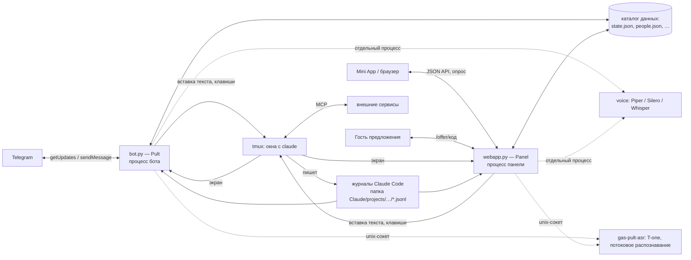

# Архитектура

Состояние — на `main` после #73 (03.11.2026). Что ещё в работе и не слито — раздел «В работе» в конце.

## Как устроено целиком



Два процесса — **бот** (`gas-pult run`) и **панель** (`gas-pult webapp`) — над одним ядром и общими файлами в каталоге
данных. Друг с другом напрямую они не разговаривают: общее — окна tmux, журналы Claude Code и файлы состояния; в
одно окно в каждый момент пишет кто-то один (замки `flock` в `locks/`). Claude Code не патчится: пульт читает его
журналы и экран и вставляет ввод как обычный текст.

## Модули кода

```
src/gas_pult/
├── cli.py          команды: run, init, doctor, voices, service, asr, webapp, geoip, offer, last, version
├── config.py       config.toml + токен; каталоги (GAS_PULT_CONFIG_DIR / GAS_PULT_DATA_DIR)
├── bot.py          Pult: опрос Telegram, обработчики, монитор окон, расписание модулей, сводка, демо предложений
├── telegram.py     клиент Bot API на urllib (multipart, скачивание, маскирование токена)
├── channels.py     интерфейс канала связи Channel (Incoming, Button, Caps) и TelegramChannel поверх telegram.Api
├── tmux.py         окна, экран, bracketed paste, новые окна с Claude
├── transcripts.py  jsonl Claude Code: Turns (сборка хода до end_turn), Tail, last_answer, clean
├── projects.py     «Проекты» (docs/PROJECTS.md): projects.json, миграция из папок и окон, окно → проект, чаты
├── deliveries.py   журнал доставок sends.jsonl (без текста); перепроверка и сторож поля ввода — bot.Pult
├── activity.py     строка статуса: хвост jsonl + экран → «Читает файл X · 12 с»; фазы Отправлено/Доставлено/Взял
├── ago.py          «изменена N назад»: шкала «12 с назад → 5 мин → … → дата», формы числа ru/en, смена экрана окна
├── commands.py     блоки bash из ответа → кнопки ▶️, классификация, выполнение; Journal — вкладка «Команды»
├── termwin.py      команде нужен ввод (keepassxc-cli, sudo, ssh…) → окно терминала gp-term вместо ▶️
│                   и живой терминал панели: клавиши и текст в окно, вся история tmux страницами (задача 50)
├── digest.py       утренняя сводка «ждёт владельца»: PR (gh), окна с вопросом, строки о решениях из HANDOFF.md
├── people.py       роли (владелец / участник / наблюдатель), согласие с условиями, страна, папка Claude человека
├── personas.py     роли интерфейса: access_role (права) отдельно от ui_persona (вид), возможности cap.*, потолок
├── terms.py        условия использования: версия и короткий текст для бота и панели (полный — docs/TERMS.md)
├── country.py      страна человека: выбор, код номера (хеш с солью), GeoIP по локальной базе db-ip lite
├── models.py       профили поставщиков (Claude, OpenRouter, GLM, DeepSeek, GigaChat и YandexGPT через шлюз), страны,
│                   что работает у поставщика (CAPS: limits/unsure/works/alt — docs/PROVIDERS.md)
├── selftest.py     автотест поставщиков раз в сутки: claude -p — CLAUDE.md, инструменты, Read, WebFetch
├── openrouter.py   вход в OpenRouter (OAuth PKCE), ключ и каталог моделей
├── fallback.py     запасные: отказ поставщика в журнале → следующий по цепочке с учётом стран и ключей
├── usage.py        расход: токены и USD по журналам (прайс Anthropic, счёт OpenRouter, оценка Z.ai/DeepSeek), пулы по учёткам, лимиты и пауза
├── tenants.py      демо-пространства: список, включено ли, окна через sudo -u … tmux -S (docs/TENANTS.md)
├── rogroup.py      группа pult-ro у бота и панели: sg / newgrp при запуске, проверка в doctor (docs/TENANTS.md)
├── tenant_admin.py bin/pult-tenant владельца: create, list, backup, destroy, purge, key, login (через sudo)
├── modules.py      модули-агенты: каталог templates/modules (module.toml), общие блоки _common, пространство, расписание
├── scenarios.py    «Примерочная»: роли из templates/scenarios (*.toml), день с агентом, калькулятор пользы без eval
├── offers.py       предложения бизнесу: /offer/<код>, демо-данные, сценарий Telegram, защита (docs/OFFERS.md)
├── offer_report.py «Загрузите выгрузку — отчёт за 2 минуты»: CSV/XLSX → сводка без модели, в памяти
├── helper.py       дежурный помощник «? Подсказать»: карта экранов, ответы без модели, журнал без ПДн
├── humanize.py     простой режим: экран Claude Code → вопрос по-русски/по-английски и чипы, ошибки, белый список
├── help/
│   └── screens.toml карта экранов помощника: реальные экраны, переходы go:…, чипы (тест сверяет с index.html)
├── setup.py        мастер без Claude: status() (установлен, вход, ключи), вход claude auth login в окне tmux
├── logins.py       «Нужен вход» на экране окна: detect() — ссылка, одноразовый код, что окно ждёт (claude/mcp/gh/device)
├── webapp.py       панель: HTTP-сервер на стандартной библиотеке, JSON API, страница предложения
├── webauth.py      вход из браузера: через Telegram (TgLogins) и запасной код владельцу, cookie-сессии
├── emailcode.py    вход по коду на почту, второй фактор, письма-оповещения (SMTP_SSL, stdlib)
├── passkeys.py     вход по ключу (WebAuthn): необязательный пакет webauthn, импорт ленивый
├── repos.py        репозитории GitHub в живой сессии: clone/pull, /add-dir, --add-dir при перезапуске (задача 43)
├── mcp.py          MCP-серверы Claude Code через `claude mcp`: коннекторы claude.ai, шаблоны PRESETS, свой сервер
├── providers.py    ключи API (secrets.json, 0600) и ElevenLabs: озвучка, распознавание, голоса
├── templates/
│   ├── modules/    31 модуль-агент (3 общих + 28 отраслевых в шести отраслях) и общие блоки _common/ (5)
│   ├── scenarios/  роли «Примерочной»: carwash-owner.toml, uk-director.toml
│   └── offers/     example.toml — пример предложения (настоящие — вне репозитория)
├── web/
│   ├── index.html  разметка и JS панели, без сборки; ?demo — демо-данные
│   ├── css/        стили по разделам, в <head> по порядку каскада: tokens (цвета, размеры), base (каркас, шапка,
│   │               список, кнопки, формы), chat, terminal, voice (нижняя панель и озвучка), screens (команды,
│   │               интеграции, модули, шторки, широкий экран, уведомления, помощник, тур), simple, nav
│   ├── js/         обычные <script> перед основным (встроенным) — порядок = порядок выполнения:
│   │               demo.js — демо-данные (?demo, demoApi), только функции; строку R["/api/scenarios"] в нём
│   │               обновляет python -m gas_pult.scenarios;
│   │               core/store.js — общее состояние (tg, params, DEMO, FOCUS, sessions, view…), $, esc, store();
│   │               core/i18n.js — язык и словарь (LANG, DICT, loadDict, T, L, LL); core/ui.js — значки ic(),
│   │               тема, копирование, ссылки, время, toast, busy, sheet, confirmDanger; core/api.js — api(),
│   │               подтверждение кодом;
│   │               разделы основного скрипта — непрерывными кусками сверху вниз, порядок прежний: nav.js —
│   │               широкий экран (ширина, свёртка, шрифт, полоса значков), панель чатов, новый чат
│   │               shell.js — навигация (show, «Назад», прячущиеся панели, прокрутка ленты, «потяните, чтобы обновить»), зона уведомлений, новая версия панели, точечное обновление (morph), разметка ответов
│   │               login.js — вход: приглашение, условия, страна, Telegram, ключи входа, Google и Яндекс ID, почта, второй фактор
│   │               home.js — главная (статус сессий), «изменена N назад», демо-пространства, лёгкий вход по приглашению
│   │               terminal.js — команде нужен ввод — окно терминала, живой терминал
│   │               usage.js — расход: токены и деньги, лимиты, пауза
│   ├── offer.html  страница предложения /offer/<код>, тоже один файл без сборки
│   ├── whatsnew.json  «Что нового» — показывается один раз после обновления
│   ├── i18n/       ru.json, en.json — строки простого режима, первого экрана и пересказа вопросов (GET /i18n/…)
│   └── help-map.json  карта помощника для демо (собирается из help/screens.toml: python -m gas_pult.helper)
├── wsock.py        WebSocket на stdlib (RFC 6455, сторона сервера) — для /api/stt/stream
├── asr/            потоковое распознавание речи (задача 46)
│   ├── __init__.py клиент службы и протокол (кадры JSON и PCM по unix-сокету); нет службы — Unavailable
│   ├── service.py  служба gas-pult-asr: модель в памяти, потоки распознавания (только stdlib, движок — снаружи)
│   ├── tone.py     движок T-one (numpy + onnxruntime, только в venv службы): фразы по паузам, жадный декодер, 16→8 кГц
│   ├── install.py  gas-pult asr install: venv, модель с проверкой sha256, юнит с MemoryMax=1G
│   └── gas-pult-asr.service, requirements.txt  шаблон юнита и точные версии пакетов службы
└── voice/
    ├── __init__.py synth() / transcribe() — запускают рабочий процесс; transcribe_any() — служба T-one, иначе whisper
    ├── __main__.py рабочий процесс: Piper, Silero, faster-whisper, ffmpeg
    ├── catalog.py  голоса, их подписи и установка моделей
    └── text.py     нарезка текста для синтеза
```

## Потоки бота

Процесс бота (`Pult.run`) держит несколько потоков:

1. **Опрос** — `getUpdates` с long polling раз в 60 секунд. Каждое обновление обрабатывается в своём потоке, поэтому
   долгий синтез или ожидание Claude не блокируют остальные. Фильтр `Pult.admitted()`: владельцы — всё; незнакомые —
   только начало входа в панель (`/start login_…`, кнопки `lg:`) и демо предложения (`/start demo_…`, кнопки `dm:`);
   люди с ролью — по своим правам.
2. **Монитор** (`Pult.monitor`), каждые 3 секунды:
   - окна сессии tmux, где запущен `claude` (по процессам терминала окна, а не по `pane_current_command`);
   - транскрипты `<папка Claude>/projects/<папка>/*.jsonl` — `Tail` дочитывает новые строки, `Turns` собирает текст
     хода и отдаёт его на `stop_reason == "end_turn"`;
   - экран окна: при диалоге (`DIALOG`) — снимок с кнопками клавиш, не чаще одного раза на изменение экрана;
     заодно `ago.Screens` запоминает, когда экран над полем ввода менялся (для «изменена N назад» в 📋 и `/status`);
   - запасные (`fallback.Switcher`): отказ поставщика в журнале → перезапуск окна на следующем профиле;
   - расход (`usage.py`), раз в 10 секунд и только если задан лимит: превышение — Esc, пауза окна, один вопрос
     владельцу. Журналы дочитываются по смещению; пул — папка Claude Code (владелец и участник со своей папкой — врозь).
3. **Сводка** (`digest_loop`) — утренняя сводка владельцу раз в день (`digest_at`); 1-го числа — отчёт по функциям
   панели (`features.py`): что не открывали 30 дней и что в ходу.
4. **Расписание модулей** (`modules_loop`) — раз в минуту: `modules.Schedule.due` по пространствам, созданным из
   модулей (отметка `.gas-pult-module`); задание уходит в окно пространства, окна нет — пульт открывает его.
5. **Строка статуса** (`Pult.follow`) — на каждое отправленное сообщение свой короткий поток: правит одно служебное
   сообщение «⏳ Отправлено → 📨 Доставлено → ✅ Взял в работу · …» не чаще раза в 3 с.

Окна с `claude --channels` (у окна свой Telegram-плагин) монитор пропускает, чтобы ответы не приходили дважды.

## Панель (webapp.py)

HTTP-сервер на `http.server` (поток на запрос). Вход — `initData` Telegram или cookie-сессия браузера (`webauth.py`);
роль проверяется на каждый запрос (`people.py`). Множество `OWNER_ONLY` — эндпоинты только владельцу (выполнение
команд, ключи, модели, люди, запасные, лимиты расхода, мастер установки). Новые поля и эндпоинты API — только
добавлением. Фоновые потоки панели: имя бота и прогрев GeoIP при старте, уборка демо-отчётов предложений раз в минуту.

Группы API (`/api/…`): сессии и переписка (`sessions`, `meta`, `history`, `screen`, `send`, `key`, `select`, `new`,
`folder`, `close`, `restart`, `revive`, `rename`, `active`, `last`, `hint`), строка статуса (`activity`), команды
(`cmds`, `run`, `command`, `commands*`), голос (`stt`, `tts`, `voice/*`, `providers`, `keys*`), модели (`model`,
`models`, `effort`, `openrouter/*`, `fallback`), расход (`cost/limits`, `cost/decide`), люди и вход (`people*`,
`login/*`, `logout`, `terms*`, `country`), MCP (`mcp*`), мастер (`setup/*`), модули (`modules`, `modules/create`),
«Примерочная» (`scenarios`), роли интерфейса (`persona`; `team` — только владельцу), простой режим (`prefs`, `ask`; словари `/i18n/ru.json`, `/i18n/en.json` — и до входа),
предложения (`/offer/<код>`, `/api/offer/<код>/…`).

| Модуль | Что делает |
|---|---|
| `webapp.py` | HTTP-сервер панели на стандартной библиотеке: проверка `initData` / сессии браузера, API сессий, переписки, экрана, ввода, голоса, команд, MCP, модулей, сценариев; страница предложения без входа |
| `web/index.html` | Весь интерфейс одной страницей (Telegram WebApp JS, marked + DOMPurify); стили — `web/css/*.css` (порядок подключения = порядок каскада), цвета — токены `web/css/tokens.css`, значки — `ic("имя")`; `?demo` — демо-данные для показа и скриншотов |
| `web/whatsnew.json` | «Что нового» — показывается один раз после обновления |
| `deliveries.py` | Журнал доставок `<данные>/sends.jsonl` (0600, ротация 5000 строк): время, окно, источник, длина, отпечатки sha256 (весь текст и первые 40 знаков без пробелов), итог вставки и что осталось в поле ввода — без самого текста. На нём `Pult.recheck` (через 3/10/30 с после доставки: наш текст в поле и окно свободно — Enter ещё раз; висит — «Не отправлено» и сообщение владельцу с кнопкой) и сторож в мониторе бота (`draft_watch`: доставка за час висит в поле дольше 2 мин). Поле ввода — строка «❯» между рамками (`tmux.prompt_field`): «❯» стоит и у выбранной строки списков под полем |
| `activity.py` | Живая строка статуса: последний незакрытый `tool_use` в хвосте журнала → человеческие слова (секреты в командах скрыты, у ссылок — только домен), спиннер Claude с экрана, фазы до хода (`Sends`: отправлено, доставлено, 20 с без реакции — «в очереди» или «не видно реакции»). `GET /api/activity?w=` — опрос из открытого чата раз в 1,5 с во время хода и 4,5 с в тишине (окна кэшируются на 3 с, экран — не чаще раза в 2 с, разбор — по размеру и времени файла); бот правит одно служебное сообщение (`Pult.follow`). Опрос, а не SSE: ответ — сотня байт, Caddy и сервер не меняются |
| `ago.py` | Когда сессия менялась: последний ход в журнале (`activity.parse`: `last`, `said` — последний текст агента, `turn` — ваше сообщение) или смена экрана окна над полем ввода (`Screens`, в памяти процесса; первый взгляд — «неизвестно»). В `/api/sessions` — поля `changed`, `said`, `asked` (Unix-время или `null`) и `now` (часы сервера). Шкала: до 5 с «только что», секунды, минуты, часы, «вчера» (до двух суток), дни, недели, месяцы, дальше дата; короткая форма («5 мин») — карточки и 📋, полная («5 минут назад») — шапка и бот. Тексты — словари `ago.*`; те же правила в `index.html` (`agoText`), тест сверяет обе реализации (`tests/test_ago.py`, в браузере — `tests/e2e/ago_check.py`) |
| `webauth.py` | Вход из браузера: через Telegram (ссылка `t.me/<бот>?start=login_…`, браузер опрашивает по своему `rid`) и запасной код владельцу; cookie-сессия, хранятся только хеши |
| `passkeys.py` | Вход по ключу (Face ID, passkey): регистрация из настроек и вход, одноразовые вызовы на сервере, лимит по IP, `sign_count`; проверка подписей — extra `webauthn`, без него или без `[passkeys]` выключено ([AUTH.md](AUTH.md)) |
| `emailcode.py` | Вход по коду на почту (6 цифр, 10 мин, 5 попыток, только HMAC; лимиты 1/мин и 5/ч), привязка адреса кодом, второй фактор после Telegram, `notify_email`; SMTP — `[email]` в config.toml, выключено без настроек ([AUTH.md](AUTH.md)) |
| `logins.py` | Шторка «Нужен вход» (только владельцу): `detect(lines)` → `{kind: claude\|mcp\|gh\|device\|url, service, url, code, wants}` по низу экрана при паре «ссылка + слово входа»; поле `login` в `/api/screen` и `/api/tty`; `POST /api/login/code` — одна строка ≤ 512 в окно (`tmux.paste`), `POST /api/login/check` — `claude auth status` / `gh auth status` / `claude mcp list` |
| `setup.py` | Мастер первого запуска: `status()` (`claude --version`, `claude auth status --json`, ключи), `Login` — `claude auth login` в окне `<сессия>-setup` с меткой `login`, ссылка с экрана, код в окно; `/api/setup/*` |
| `mcp.py` | MCP-серверы Claude Code через `claude mcp`: список, коннекторы claude.ai, шаблоны `PRESETS`, добавление, удаление — в папке Claude того, кто подключает |
| `providers.py` | Ключи API (`secrets.json`, 0600) и ElevenLabs: озвучка, распознавание, голоса |
| `fallback.py` | Запасные: распознаёт отказ поставщика модели в транскрипте (`classify_entry`), выбирает следующего по цепочке `fallback_chain` (state.json) с учётом стран (`models.allowed`), адреса шлюза и ключей, перезапускает окно с `--continue` и пишет одну строку; монитор бота вызывает `Switcher.seen/step`. `GET/POST /api/fallback` — цепочка в панели |

Добавить шаблон интеграции — запись в `PRESETS` (`mcp.py`): `title`, `about`, `type`, `url`, `fields`
(у поля `label`, `hint`, `placeholder`, `secret`, `header`/`format`). Форма в панели строится сама.

## Подсистемы

### Люди, условия, страны, папка Claude у каждого

- **Роли** (`people.py`): владелец — `owners` в `config.toml`; участники и наблюдатели — `people.json` (0600).
  Вход человека — «Войти через Telegram» → START в боте → владелец даёт роль кнопкой.
- **Своя папка Claude Code** у каждого человека из `people.json` — `<data>/people/<id>/claude` (`CLAUDE_CONFIG_DIR`):
  свой вход в Claude, свои MCP, свои журналы. Окна человека помечены `@gas_pult_by`; `people.home_of` по окну находит,
  в какой папке искать журналы (окна владельца — `~/.claude`). Решение — [ADR 0001](adr/0001-claude-config-per-person.md).
- **Роли интерфейса** (`personas.py`): права (`access_role`: владелец → `owner`, участник → `staff`, наблюдатель →
  `guest`) отдельно от вида (`ui_persona`: `business_owner`, `point_admin`, `project_manager`, `student`, `developer`).
  Вид — набор возможностей `cap.*`: `(пресет роли ∪ добавленные) − скрытые, ∩ потолок по access_role`. Потолок
  владельцу — всё, гостю — `GUEST`, сотруднику — что разрешил владелец (`<data>/team.json`; не задано — всё, как до
  ролей). Потолок — это права: `permit` не пускает к API из `CAP_PATHS` того, у кого возможности нет в потолке (403
  `code="cap"`); скрытое в виде сервер не закрывает. Вид хранится у человека (`ui` в people.json, у владельцев —
  `ui.json`), простой режим (#80) следует за видом: нет `cap.dev_sessions` — чат. `GET/POST /api/persona`,
  `GET/POST /api/team`, поле `ui` в `/api/meta`.
- **Условия** (`terms.py`, `VERSION`): без согласия с текущей версией человек не работает; подняли версию — бот и
  панель спрашивают заново. Полный текст — [TERMS.md](TERMS.md) (черновик, на проверку юристу).
- **Страна** (`country.py`): выбор, код номера телефона из «Поделиться номером» (хранится только HMAC с солью
  установки), страна IP по локальной базе db-ip lite. Поставщик доступен, только если разрешён и для стран человека,
  и для `region` сервера (`models.allowed`). Если ни одного — ровно «Этот сервис недоступен в вашей стране по условиям
  поставщика» (`models.DENY`, `country.DENY`, та же строка в `index.html` и `offer.html`). Обходов нет.

### Модели других поставщиков и РФ-профили

`models.py`: профиль — набор переменных Anthropic-совместимого API (`ANTHROPIC_BASE_URL`, `ANTHROPIC_AUTH_TOKEN`,
модели ролей); сессия запускается `claude --settings <config>/profiles/<id>.json` (файл 0600, ключа нет в командной
строке и в tmux). Профили: Claude (обычный запуск), OpenRouter, GLM (Z.ai), DeepSeek, **GigaChat и YandexGPT через
шлюз клиента** (`gateway: True`, `regions = {"RU"}`, без адреса по умолчанию — адрес шлюза задаёт владелец,
`model_profiles[id].base_url` в state.json). Для RU доступны только эти два, для остальных стран они закрыты.
Официального Anthropic-совместимого API у Сбера и Яндекса нет — шлюз (gpt2giga, LiteLLM) ставит клиент у себя в
России. Подробно — [RU-MODELS.md](RU-MODELS.md), условия поставщиков и стран — [COMPLIANCE.md](COMPLIANCE.md).

### Расход и лимиты (usage.py)

Токены четырёх видов и USD по журналам Claude Code (включая субагентов), по сессии окна и за сегодня; цены — таблица
`PRICES` с датой сверки (прайс API Anthropic). Чужие модели — по поставщику ответа (задача 51; цену Claude Code для
них не берём — он считает их по тарифам Anthropic): OpenRouter — счёт за каждый ответ (`openrouter.Billing`,
`/api/v1/generation` по `requestId` «gen-…», в фоне, кэш `openrouter-costs.json`), Z.ai и DeepSeek — оценка по токенам
и тарифу `models.PROVIDER_PRICES`; источник — поле `cost_source`. Шлюзы и незнакомые модели — «цена неизвестна». **Пул — папка Claude Code**:
учётка владельца — один пул, участник со своей папкой — свой; чужие учётки в общий пул не собираются. Лимиты на
сессию и на день — `cost_limits` в state.json, задаёт только владелец (`/api/cost/limits`). Превышение: Esc, если
Claude работает, окно в `cost_paused` (текст туда не отправляется), владельцу один вопрос «Продолжить, +лимит /
Остановить» — решение общее для бота и панели (`Pult.cost_decide`, `/api/cost/decide`).

### Демо-пространства (tenants.py, bin/pult-tenant)

Пространство — отдельный пользователь Linux `pult_t_<slug>`, папка `/srv/pult/tenants/<slug>` на своём образе ext4,
свой сервер tmux в slice systemd с лимитами и своя папка Claude Code; модель — профиль с ключом API. Создаёт и убирает
их владелец скриптами через sudo; пульт только открывает окна (`sudo -n -u … tmux -S …`) и читает журналы (группа
`pult-ro`). Без настройки функция выключена. Подробно, с шагами и откатом, — [TENANTS.md](TENANTS.md).

### Модули-агенты (modules.py, templates/modules)

Модуль — **папка без кода**: `templates/modules/<id>/` в пакете или `<config>/modules/<id>/` (свой одноимённый
заменяет встроенный). В папке `module.toml` (название, отрасль `industry`, интеграции, `data_sources` — только
`official_api` или `client_export`, `[[schedule]]`, `[[decisions]]`, `[settings]` с подстановкой `{{ключ}}`,
необязательные `[demo]` и `[[demo.telegram]]`), `CLAUDE.md`, `skills/`, `settings.json`, пример данных. Общие блоки —
`_common/<id>/` (`reminders`, `reviews`, `receivables`, `documents`, `deadlines`), подключаются полем `uses`: навыки
копируются, правила дописываются в `CLAUDE.md`. Ошибка в toml — понятный текст, модуль просто не попадает в каталог.

- **Пространство** (`modules.create`): новая папка в первом корне `project_roots`, отметка `.gas-pult-module`
  (id, версия, кто создал), `git init`; существующая папка не перезаписывается. Затем окно с Claude и первое задание
  модуля, когда Claude готов. Панель — «Новая сессия» → «Из модуля» (`/api/modules`, `/api/modules/create`), бот —
  `/modules` (в два шага: общие модули и кнопки отраслей). Пустая папка без модуля — «Новая папка»
  (`/api/folder`, `Pult.make_folder` — общее для бота и панели).
- **Расписание** `[[schedule]]`: `at` (время и `days`), `every` (каждые N минут, 5–240, в окне `at`–`until`, без
  догонялок) или `workday` (N-й рабочий день месяца по производственному календарю блока `deadlines`); `every` и
  `workday` в одном пункте нельзя. Что уже отправлено — `modules.json`.
- **Решения кнопками** — существующий механизм: агент спрашивает инструментом AskUserQuestion, монитор показывает
  меню кнопками, панель — вариантами.

Формат и отраслевые модули — [MODULES.md](MODULES.md).

### «Примерочная» (scenarios.py, templates/scenarios)

Экран «Примерить на себя»: роль → день с агентом по шагам → калькулятор пользы → «Подключить» (экран модуля из
«Из модуля»). Роль — `templates/scenarios/<роль>.toml` (свои — `<config>/scenarios/`): `[[timeline_steps]]` со
временем, сообщением агента и `decisions` — кнопки **ровно как в модуле** (варианты его `[[decisions]]` или
`[[demo.telegram]]`, иначе сценарий не загрузится) и `outcome_toast`; `[calculator]` — вводные с min/max/step и
`formulas` — **только произведение вводных × коэффициент**, диапазон low–high, без выражений и без eval (`benefit()` в
Python и `benefitCalc` в `index.html` — один расчёт, тест сверяет). `GET /api/scenarios` — любой роли (ошибки битых
файлов — только владельцу). [SCENARIOS.md](SCENARIOS.md) и демо-данные панели собираются из toml:
`python -m gas_pult.scenarios`. Сейчас две роли: владелец сети автомоек, директор УК.

### Предложения бизнесу (offers.py, offer_report.py, web/offer.html)

- Предложение — `<config>/offers/<код>.toml` (0600, **вне репозитория**; в репо — только `templates/offers/example.toml`).
  Код — `secrets.token_urlsafe(18)`; создаёт и отзывает только CLI (`gas-pult offer new|list|revoke|example`).
- `/offer/<код>` — страница без входа: боли клиента, 1–3 модуля, живое демо на выдуманных данных (детерминированно из
  toml), «Загрузите выгрузку», «Попробовать в Telegram», мастер «Подключить» (условия → страна → модуль → вход через
  Telegram с пометкой предложения у владельца).
- **Изоляция от панели**: эндпоинты `/api/offer/<код>/…` умеют только своё; демо-cookie `gp_offer` отдельная, с ней
  `/api/sessions` и прочее — 401. Нет / отозвано / просрочено — один и тот же 404, перебор кодов — 429; `noindex`,
  CSP по sha256, `no-store`, `robots.txt` с `Disallow: /offer/`.
- **Отчёт по выгрузке** (`offer_report.py`): CSV/XLSX → продажи / клиенты / должники, без модели, разбор в памяти
  (на диск ничего), в памяти — агрегаты и маскированные строки на 30 минут; XLSX — с защитой от zip-бомбы и
  внешних сущностей.
- **Демо в боте**: панель выдаёт короткоживущий токен (`offer_tg.json`), ссылка `t.me/<бот>?start=demo_<токен>`; бот
  проигрывает 3–4 сообщения сценария (`[[demo.telegram]]` модуля или по умолчанию) с работающими кнопками; владельцу
  ничего не приходит, пока человек не нажал «Подключить».

Подробно — [OFFERS.md](OFFERS.md).

### Каналы (channels.py)

Интерфейс канала связи `Channel` (`Incoming`, `Button`, `Caps`) и `TelegramChannel` поверх `telegram.Api`. Бот пока
вызывает `telegram.Api` напрямую; перевод бота на интерфейс и другие каналы (MAX, VK — только с поставщиком,
разрешённым для России) — план в [CHANNELS.md](CHANNELS.md).

## Состояние

`~/.local/share/gas-pult/` (или `GAS_PULT_DATA_DIR`):

| Файл | Что |
|---|---|
| `state.json` | активное окно, уведомления, голос, «всегда голосом», `audio_only`; профили моделей (`model_profiles`), цепочка запасных (`fallback_chain`, `fallback_log`); лимиты расхода и паузы (`cost_limits`, `cost_paused`, `cost_extra`, `cost_day_extra`) |
| `modules.json` | расписание пространств из модулей: что и в какой день уже отправлено |
| `digest.json` | утренняя сводка: когда слали, что отложено, пункты последней сводки |
| `cmds.json` | последние 200 команд для ▶️ (0600) |
| `commands-log.json` | вкладка «Команды» панели: последние 400 команд всех сессий, отметка «выполнено» и код, отпечатки ошибок, уже отправленных на разбор (0600) |
| `people.json` | участники и наблюдатели: роль, имя, согласие с условиями `terms: {version, at}`, страна (0600) |
| `tg_logins.json`, `web_sessions.json` | ожидающие входы через Telegram и сессии браузера — только хеши |
| `terms.json` | согласие с условиями использования владельцев (их нет в `people.json`) (0600) |
| `countries.json` | страна владельцев (признаки: выбор, код номера и его хеш, страна по IP; у остальных — `country` в `people.json`) (0600) |
| `country_salt` | соль установки для хеша номеров телефонов (0600, создаётся один раз) |
| `geoip/dbip-country-lite.csv.gz` | база стран по IP (db-ip lite, CC BY 4.0) — `gas-pult geoip update` |
| `offer_tg.json` | токены «Попробовать в Telegram» для демо предложений |
| `features.json`, `usage-ГГГГ-ММ.md` | какими функциями панели пользуются (`features.py`): id экрана, листа или действия → последнее открытие и счёт по дням за 40 дней, без людей и текста; функция — не чаще раза в минуту. 1-го числа бот (`digest_loop`) шлёт владельцам отчёт и пишет файл: что не открывали 30 дней и что в ходу; сейчас — `gas-pult usage report` (0600) |
| `locks/` | замки окон (`flock`): в окно пишет кто-то один — бот или панель |
| `outputs/` | весь вывод выполненных команд (до 1 МБ, хранится месяц) — для «Копировать вывод» (0600) |
| `inbox/` | файлы и голосовые из Telegram и панели |
| `people/<id>/claude/` | папка Claude Code участника (`CLAUDE_CONFIG_DIR`, 0700): его вход, MCP, журналы; окна с ней помечены `@gas_pult_by` (ADR 0001) |
| `voices/`, `silero/`, `voice-preview/` | модели голосов и кеш фраз «Послушать» |

`~/.config/gas-pult/` (или `GAS_PULT_CONFIG_DIR`): `config.toml`, `token` (0600), `secrets.json` (ключи API, 0600),
`profiles/<id>.json` (профили моделей, 0600), `offers/` (предложения, 0600; отозванные — `offers/revoked/`),
`modules/` и `scenarios/` (свои модули и роли «Примерочной»).

## Как расширить

- **Кнопка в ⚡ Команды** — без кода: `commands = [["подпись", "текст или /команда"]]` в `config.toml`.
  Встроенные — `COMMANDS` в `bot.py`.
- **Голос Piper** — имя в `catalog.PIPER`. Модель скачивается с `rhasspy/piper-voices` по шаблону
  `ru_RU-<имя>-medium`. Для других языков нужно обобщить `PIPER_HF` и `piper_model()`. Piper — запасной синтез, в
  выборе голоса его нет; Silero (некоммерческая лицензия) — только владельцу при `personal_voices = true`.
- **Движок синтеза** — функция `<движок>_wav(voice, src, wav)` в `voice/__main__.py`, ветка в `tts()`,
  голоса в `catalog`. Тяжёлые импорты — внутри функции.
- **Распознавание** — служба T-one (`asr/`); запасное — `stt()` в `voice/__main__.py`, модель задаётся ключом
  `whisper_model`. Другой потоковый движок — класс с `stream(rate)` → `feed(pcm)` / `finish()` по образцу
  `asr/tone.py` и строка в `asr/service.py`.
- **Модуль-агент** — без кода: папка `templates/modules/<id>/` в пакете или `~/.config/gas-pult/modules/<id>/`
  (`module.toml`, `CLAUDE.md`, `skills/`, пример данных); общие блоки — `_common/<id>/`. Формат — [MODULES.md](MODULES.md).
- **Роль «Примерочной»** — без кода: `templates/scenarios/<роль>.toml` (схема — [SCENARIOS.md](SCENARIOS.md)), затем
  `python -m gas_pult.scenarios` пересобирает документ и демо-данные.
- **Поставщик модели** — запись в `models.PROFILES` (адрес, ключ, модели, `regions`); страны — по условиям
  поставщика, с первоисточником в [COMPLIANCE.md](COMPLIANCE.md).
- **Канал связи** (MAX, VK, почта…) — класс с методами `Channel` из `channels.py` и разбором событий в `Incoming`.
  Обзор каналов и шаги перевода бота на интерфейс — [CHANNELS.md](CHANNELS.md).

## Решения

- **Без зависимостей в ядре.** Пульт должен ставиться и работать там, где есть Python и tmux. Bot API на urllib —
  это около 40 строк. Данные модулей, сценариев и предложений — TOML: `tomllib` есть в стандартной библиотеке, YAML нет.
- **Голос в отдельном процессе.** torch и onnxruntime занимают сотни мегабайт и иногда падают. Процесс на каждый
  синтез добавляет 1–2 секунды, зато бот остаётся лёгким и живучим.
- **Распознавание — постоянная служба `gas-pult-asr`** (задача 46, замер — `docs/metrics/asr-2026-11.md`). T-one
  грузится один раз (≈ 0,55 ГБ), юнит ограничен `MemoryMax=1G` без свопа. Панель шлёт звук PCM 16 кГц по WebSocket
  `/api/stt/stream`, сервер панели пересылает его в службу по unix-сокету и возвращает частичный текст; бот и
  запасной `/api/stt` отдают службе готовую запись. Службы нет или сбой — прежний путь (ElevenLabs или whisper),
  панель в этом случае отправляет ту же запись файлом WAV. Вход в WebSocket — первым сообщением (браузер не шлёт туда
  заголовки), страница проверяется по `Origin`.
- **Не патчить Claude Code.** Только транскрипты, экран и ввод. Это переживает обновления Claude Code.
- **tmux в своей группе systemd** (`systemd-run --scope`). Перезапуск службы пульта не убивает окна с Claude.
- **Опрос вместо долгих соединений** (строка статуса): в WebView Telegram опрос надёжнее, Caddy не трогаем.
- **Данные клиентов — только официальные API и выгрузки клиента**; парсинга кабинетов и скрейпинга нет.
- **Своя учётка Claude у каждого** (ADR 0001): чужие учётки не смешиваются ни во входе, ни в расходе.

## Дежурный помощник «? Подсказать» (итерация 1, #74)

- `helper.py` + карта экранов `help/screens.toml` (TOML: ядро — stdlib, YAML-парсера нет): `[[screen]]` — реальный
  экран, лист или шаг мастера (панель или `/offer`), `[[action]]` — именованный переход `go:…`, `[[faq]]`/чипы.
  Тест сверяет карту с `index.html`/`offer.html` в обе стороны: каждый лист (`helpSheet`/`data-help`) и экран-форма
  (`formHelp`) есть в карте, в карте нет выдуманных экранов; у каждого действия есть обработчик `go(id)`.
- Пилюля в шапке, в каждом листе и на `/offer/<код>` → шторка 55 %: «что здесь делать», чипы, поле вопроса, кнопки
  «Перейти: …». Ответы — из карты, без модели (поиск по словам); переходы — только из белого списка с проверкой роли
  на сервере. Контекст экрана (`helpContext()`) санитизируется сервером; роль — с сервера, не от клиента.
- Гость предложения видит только экраны `offer.*` своей страницы. Журнал вопросов `<data>/help-log.jsonl` (0600,
  90 дней): маскировка телефонов, почты, ИНН/ОГРН, карт, СНИЛС; свободный текст гостя — только хэш; без ID, IP, кода.
- API (добавлением): `POST /api/help/ask`, `/api/help/feedback`, `/api/offer/<код>/help`, `/helpfb`,
  `GET /help-map.json` (карта для демо), `POST /api/notify-done` («Сообщить по готовности» — монитор бота шлёт одно
  сообщение по окончании хода).
- Строка статуса (#71) дополнена: фаза держится ≥ 900 мс, меняется только `textContent`, таймер `tabular-nums`;
  без нового хода 12/20/60 с — «Проверить статус», «Сообщить по готовности», «Остановить» (Esc с подтверждением).

## В работе (ещё не на `main`)

- Итерации 2 помощника (`feature/helper-chat-i2`) и «Примерочной» (`feature/scenarios-i2`) — заготовки, см. `HANDOFF.md`.
