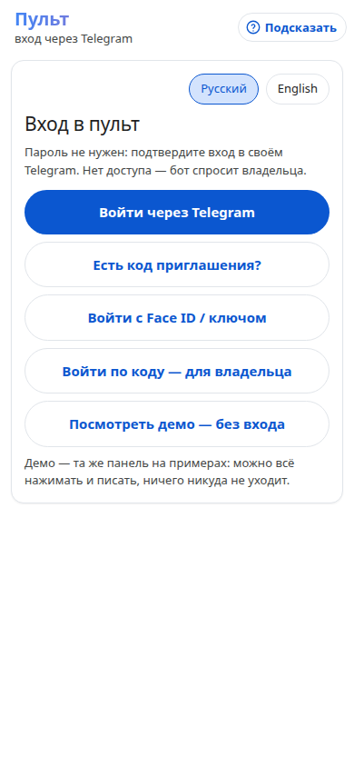
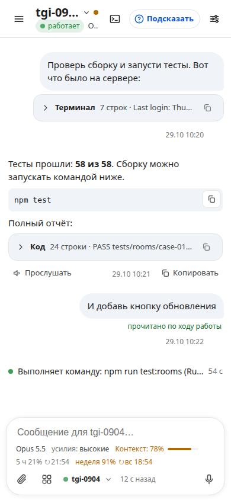
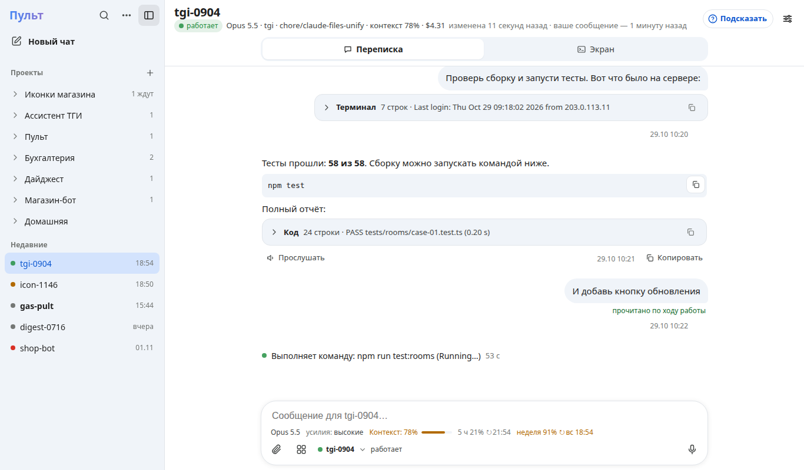

# Пульт GASTECH — зачем и как

> **Помогаю тем, кто поручает работу ИИ-агентам (Claude Code), вести её с телефона: агент работает на вашем
> сервере, а вы отвечаете ему кнопкой или голосом и не сидите у экрана.**

Для малого бизнеса — то же, но с готовыми агентами под отрасль: «Ночная смена», «Утренние цифры против плана»,
селлеры WB и Ozon, бухгалтерия, HoReCa, автомойки, фитнес-клубы, управляющие компании (30 модулей —
[MODULES.md](MODULES.md)). Агент делает рутину, человек решает: «Да» — одной кнопкой.






Снимки — живая панель в режиме демо (выдуманные данные), 13.11.2026.

## Как это работает

1. На сервере работают сессии Claude Code — каждая в своей папке проекта.
2. Агент закончил ход или спрашивает разрешение — сообщение приходит в Telegram и в панель.
3. Вы отвечаете текстом, голосом или кнопкой («Да», «1», «2») — ответ уходит в ту сессию, от которой пришло сообщение.
4. Видно, кто работает, кто ждёт, на какой модели, сколько контекста и лимита подписки осталось.

## Три отличия

| Отличие | Что это значит | Где проверить |
|---|---|---|
| **Сервер и ключи — ваши** | Пульт ставится на ваш сервер одной командой; ключи и токены остаются там (файлы 0600). Ядро — только стандартная библиотека Python, без сторонних зависимостей | [README](../README.md), [SECURITY.md](../SECURITY.md), `install.sh` |
| **Телефон вместо терминала** | Вопросы агента — кнопками, задачи — голосом (распознавание на сервере), ответы можно послушать. Несколько сессий одного проекта не путаются: ответ в Telegram уходит в окно своего сообщения | [MINI_APP.md](MINI_APP.md), `tests/test_session_routing.py`, `tests/test_e2e_lifecycle.py` |
| **Готовые агенты и демо без регистрации** | 30 модулей под отрасли; «Примерочная» — день с агентом и калькулятор; демо всей панели — кнопкой на экране входа, ничего никуда не уходит | [MODULES.md](MODULES.md), [SCENARIOS.md](SCENARIOS.md), [OFFERS.md](OFFERS.md) |

## Чем отличается от ИИ в Битрикс24

Сравнение на 14.11.2026 по открытым источникам: справка Битрикс24 о
[MCP](https://helpdesk.bitrix24.ru/open/27050746/) и о [приложении «ИИ Агенты»](https://helpdesk.bitrix24.ru/open/27694310/),
обзоры партнёров ([infoservice](https://b24.infoservice.ru/blog/ai-agenty-v-bitriks24-v-2026-godu),
[Albato](https://blog.albato.ru/ii-agenty-dlya-bitriks24/)). Сам Битрикс24 мы не пробовали; цены в источниках
расходятся.

- **Что у Битрикс24.** BitrixGPT — помощник сотрудника внутри CRM. Марта AI — агент, который выполняет действия в
  Битрикс24 и снаружи через MCP. Приложение «ИИ Агенты» — по справке 4 999 ₽/мес за 1 500 сообщений, сверх —
  3,3 ₽ за сообщение, плюс тариф портала.
- **Сходства.** Агент не только отвечает, но и делает действия. Внешние системы подключаются через MCP. Работать
  можно с телефона.
- **Главное отличие.** Битрикс24 — CRM и офис, к которым добавили ИИ: агент работает прежде всего с данными портала.
  Пульт управляет самими агентами. Агенты на вашем сервере работают в любых системах: код, сайты, браузер, 1С,
  МойСклад, почта и сам Битрикс24. Человек ведёт их с телефона и подтверждает важное.
- **Плюсы пульта:**
  1. Не привязан к одной системе: Битрикс24 — одна из интеграций.
  2. Агенты делают настоящую работу: код, выкладка, браузер и рабочий стол, фоновые задачи часами.
  3. Контроль человека встроен: подтверждение кодом, задачи по срочности и важности, видно каждый шаг.
  4. Свой сервер и любые модели: Claude, DeepSeek, GigaChat, локальная модель у заказчика.
  5. Telegram и голос — без отдельного приложения.
- **Позиционирование — поверх Битрикс24, а не вместо.** «Ваши агенты работают и в Битрикс24, и в 1С, и на сайте,
  и в почте — а вы ведёте их с телефона и подтверждаете важное».

Полное сравнение с источниками — во внутреннем репозитории портфеля (`products/pult-vs-bitrix24.md`).

## Демо для гостя

- **Панель без входа:** экран входа → «Посмотреть демо — без входа» (адрес панели + `/?demo`). Вся панель на
  примерах: можно нажимать и писать, ничего не уходит на сервер.
  Проверено вживую 13.11.2026 на боевой панели: экран входа → кнопка → демо; телефон 390 px (тёмная тема) и
  компьютер 1366 px (светлая), ошибок в консоли нет (`401 /api/meta` до входа — так и должно быть); снаружи панель
  отвечает 200 из трёх стран (check-host.net: ES, SE, US).
- **Предложение бизнесу:** страница `/offer/<код>` — его боли, 2–3 модуля с демо на похожих данных, «Загрузите
  выгрузку — отчёт за 2 минуты», «Попробовать в Telegram» ([OFFERS.md](OFFERS.md)).
  Вживую на этой неделе **не проверялось**.
- **Вход через Telegram:** «Войти через Telegram» → в боте «Start» → владелец даёт роль. Проверено тестами
  (`tests/test_people_login.py`); вживую с чужим аккаунтом на этой неделе **не проверялось**.

## Цифра пользы — замер

Источник — журналы Claude Code на сервере владельца и журнал доставок пульта; скрипт
[`tools/measure-agent-hours.py`](../tools/measure-agent-hours.py) (только чтение, повторить может любой):

```
python3 tools/measure-agent-hours.py --end 2026-11-13 --days 7 --sends-from 2026-11-11 --sends-to 2026-11-13
```

| Что измерено (06.11–12.11.2026, 7 дней, 15 проектов) | Значение |
|---|---|
| Часы работы агентов в ответ на сообщения в сессиях (владелец и сессия-штаб) | **26,6 ч** (626 ходов) |
| Из них ходы дольше 5 минут — без пульта это ожидание у экрана | **19,5 ч** (54 хода) |
| Плановые запуски по расписанию (без человека вообще) | 1,6 ч (160 запусков) |
| Доля сообщений агентам, отправленных через пульт (11–12.11) | **89 %** (271 из 305) |

**Что это значит:** за неделю агенты проработали 19,5 ч долгими ходами, и в это время владелец не сидел у экрана —
ответы и вопросы приходили в телефон; 9 из 10 сообщений агентам он отправил через пульт.

**Чего замер не говорит.** 19,5 ч — верхняя граница сбережённого времени: она предполагает, что без пульта владелец
ждал бы весь долгий ход у экрана. Сколько он ждал бы на самом деле, этот замер не показывает — для этого нужен
замер «до/после» (неделя без пульта против недели с ним). Замер — на одном человеке (владелец, разработчик),
не на клиенте-МСБ; журнал доставок пульта ведётся с 10.11, поэтому доля «через пульт» — за 2 дня. Сообщения,
которые сессия-штаб вставляет в окна проектов, журналы Claude Code не отличают от сообщений человека: они входят
в 626 ходов и в знаменатель доли (305), но не в числитель — доля через пульт скорее занижена.

## Безопасность и данные

**Где данные.** Всё — на сервере клиента: сессии, журналы Claude Code (`~/.claude`), настройки и журналы пульта
(`~/.local/share/gas-pult`, файлы 0600). Наружу уходит:

| Куда | Что | Зачем |
|---|---|---|
| Поставщик модели (Anthropic или выбранный) | сообщения и файлы, которые агент читает в работе | так работает Claude Code — пульт тут ничего не добавляет |
| Telegram Bot API | ответы агента и уведомления — тем, у кого есть роль | чат с ботом |
| SMTP клиента | коды входа и оповещения | только если клиент включил почту |

Голос распознаётся и озвучивается на сервере (Whisper, Piper); ElevenLabs — только если клиент сам добавил ключ.
Ключи, пароли и токены в сообщении пульт заменяет заглушкой до отправки агенту (`secrets_guard.py`).

**Модели** ([PROVIDERS.md](PROVIDERS.md), [COMPLIANCE.md](COMPLIANCE.md)):

| Профиль | Для кого | Состояние |
|---|---|---|
| Claude (Anthropic) | страны из списка Anthropic | основной, работает |
| OpenRouter, GLM (Z.ai), DeepSeek | страны из списков поставщиков | работают, автотест раз в сутки |
| GigaChat, YandexGPT — через шлюз клиента | клиенты в России | **не проверено** с реальным шлюзом и ключами ([RU-MODELS.md](RU-MODELS.md)); до ответа юриста клиентам в РФ не включаем |

Россия не входит в список стран Anthropic: Claude для людей из России закрыт, обхода (VPN, прокси) нет и не будет.

**Роли** — проверяются на каждый запрос; убрали человека — его вход перестаёт работать сразу ([AUTH.md](AUTH.md)):

| Роль | Что может |
|---|---|
| Владелец | всё: команды на сервере, закрыть и перезапустить сессию, ключи, модели, интеграции, люди |
| Участник | писать в сессии, отвечать агенту, новые сессии, файлы; без команд на сервере, ключей и людей |
| Наблюдатель | только смотреть |
| Гость демо-пространства | только своё пространство ([TENANTS.md](TENANTS.md)) |

**Вход:** Telegram (Mini App или «Войти через Telegram»), код владельцу, по желанию — почта, Face ID, Google,
Яндекс ID. Сессия браузера — 30 дней, продлевается, пока человек заходит. Новая сессия выполняет команды на сервере
только после кода подтверждения.

**Чего пульт не делает:** не изолирует агента (режим разрешений Claude Code — главная защита), не шифрует историю
на диске, не защищает аккаунт Telegram — включите облачный пароль ([SECURITY.md](../SECURITY.md)).

**Открытые вопросы для клиентов в России:** 152-ФЗ (персональные данные — сервер в РФ и уведомление РКН нужны до
работы с ПДн клиентов), Claude Code для клиентов в РФ на чужой модели — ждёт юриста ([COMPLIANCE.md](COMPLIANCE.md)).

## Цена

**ВЛАДЕЛЕЦ** — цену пилота (4 недели) и подписки называет владелец. Ориентир рынка из исследования GASTECH:
аудит — от 10 тыс. ₽, внедрение — от 80 тыс. ₽ в месяц (не цена пульта, а ориентир для вилки).

## Как попробовать и подключить

1. Посмотреть: экран входа панели → «Посмотреть демо — без входа».
2. Примерить на свой бизнес: «Примерочная» в панели или страница предложения `/offer/<код>` от владельца.
3. Подключить: [ONBOARDING-BUSINESS.md](ONBOARDING-BUSINESS.md) — что нужно (сервер, бот, люди), шаги с командами.
