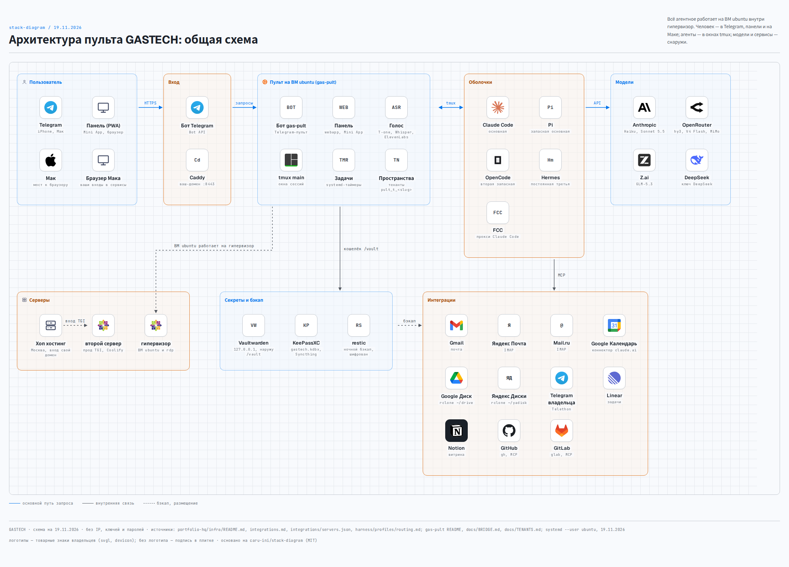
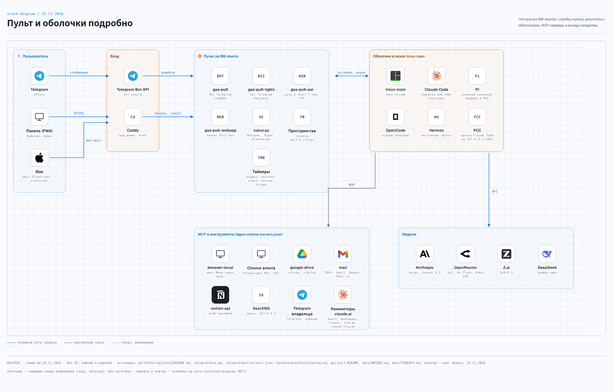

# Архитектура пульта

Схемы на **19.11.2026**. Обновляет штаб еженедельно (portfolio-hq, `automation/quality-watch`).

| Схема | Что на ней | Файлы |
|---|---|---|
| Общая | Человек (Telegram, панель, Мак) → вход (бот, Caddy) → пульт на ВМ (бот, панель, голос, задачи, пространства) → оболочки (Claude Code, Pi, OpenCode, Hermes, FCC) → модели; интеграции, секреты и бэкап, серверы | [overview.png](overview.png) · [overview.html](overview.html) |
| Подробно | Службы пульта на ВМ, окна tmux с оболочками, MCP-серверы (один список на все оболочки), выход к моделям | [detailed.png](detailed.png) · [detailed.html](detailed.html) |

**Источники:**
- portfolio-hq: `infra/README.md`, `integrations.md`, `integrations/servers.json`, `harness/profiles/routing.md`;
- этот репозиторий: `README.md`, `docs/BRIDGE.md`, `docs/TENANTS.md`;
- службы `systemd --user` на ВМ — на 19.11.2026.

**Для публичного репозитория:**
- на схемах нет IP, ключей, паролей и адресов серверов;
- адрес панели — «ваш-домен»;
- внутренние имена серверов заменены на «гипервизор», «второй сервер», «хоп»;
- HTML открывается без сети.

Схемы сделаны по образцу caru-ini/stack-diagram (MIT). Логотипы — товарные знаки их владельцев.
